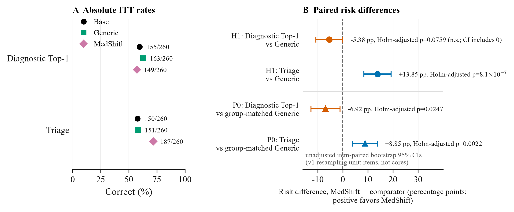
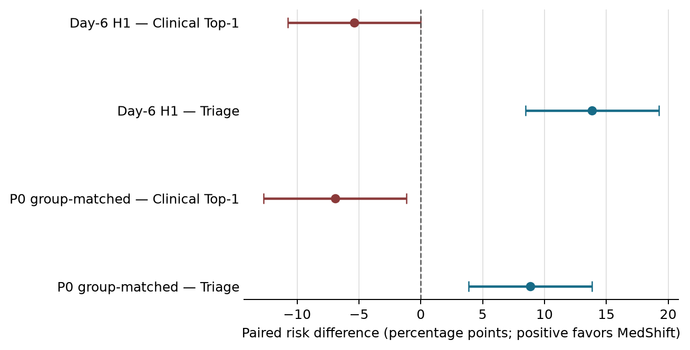

# MedShift

**Fine-tuning and evaluating clinical language models under geographic, Arabic, code-switching, and pulse-oximetry deployment shift.**

MedShift studies whether targeted shift-aware LoRA fine-tuning of **`Qwen3.5-9B`** improves clinical decision-making when the same underlying patient case is presented across different geographic settings (**GeoShift**), Modern Standard Arabic (**LanguageShift**), **Arabic–English code-switching**, and pulse-oximeter conflict (**OxiShift**). Diagnosis (**Top-1**) and urgency (**Triage**) are always scored and reported as separate co-primary endpoints under strict intention-to-treat (ITT).

> **Research disclaimer:** Constructed clinical vignettes evaluated for ML research; not validated for clinical deployment.

---

## Key Results (Blinded, 7-Human-Rater Adjudicated 260-Item Benchmark)

Base model `Qwen/Qwen3.5-9B` fine-tuned with unquantized BF16 LoRA (`r=16, α=32`, 2,000 records/arm, 500 optimizer steps, greedy decoding) and evaluated across **145 linked clinical cores / 260 prompts** (`MedShiftBench`), scored under strict ITT (missing/unparseable outputs counted as wrong) with item-paired bootstrap 95% CIs (10,000 replicates), exact McNemar tests, and Holm–Bonferroni correction:

### 1. Primary Co-Primary Results (`MedShift` vs `Generic` Medical LoRA, `n = 260`)

| Endpoint | Base (`Qwen3.5-9B`) | Generic LoRA | **MedShift LoRA** | Paired RD (`MedShift − Generic`) | 95% CI | Exact McNemar `p` | Holm `p` |
|---|---:|---:|---:|---:|---:|---:|---:|
| **Triage** | 150/260 (57.7%) | 151/260 (58.1%) | **187/260 (71.9%)** | **+13.85 pp** | **[+8.46, +19.23] pp** | `4.04 × 10⁻⁷` | **`8.08 × 10⁻⁷`** |
| **Diagnostic Top-1** | 155/260 (59.6%) | 163/260 (62.7%) | 149/260 (57.3%) | −5.38 pp | [−10.77, 0.00] pp | `0.0759` | `0.0759` (n.s.) |

### 2. Supportive GeoShift Slice & Group-Matched Control (`P0`)

| Analysis | `n` | Control / Generic | **MedShift** | Paired RD | 95% CI | Holm `p` |
|---|---:|---:|---:|---:|---:|---:|
| **GeoShift Triage** (geographic counterfactuals) | 60 | 28/60 (46.7%) | **52/60 (86.7%)** | **+40.00 pp** | [+26.67, +53.33] pp | **`8.05 × 10⁻⁶`** |
| **P0 Group-Matched Control — Triage** (1,092 matched groups) | 260 | 164/260 (63.1%) | **187/260 (71.9%)** | **+8.85 pp** | [+3.85, +13.85] pp | **`0.0022`** |

### Core Scientific Finding: Clinical Endpoint Decoupling
Targeted shift-aware fine-tuning produced a large, statistically decisive **+13.85 pp** gain in clinical triage accuracy (and **+40.0 pp** on geographic shift), replicating against a group-matched generic control (**+8.85 pp**), while differential diagnosis Top-1 did not improve alongside it (**−5.38 pp**, n.s.). Evaluating clinical LLMs with a single aggregate score hides this divergence; triage and diagnosis behave as distinct capabilities under deployment shift.





---

## Benchmark Composition (`MedShiftBench`, 145 Cores / 260 Prompts)

| Suite | Clinical Cores | Prompts | Structure |
|---|---:|---:|---|
| GeoShift | 30 | 60 | Reference + geographic counterfactual |
| Geography control | 20 | 40 | Two locations; no expected material change |
| LanguageShift | 30 | 60 | Matched English + Modern Standard Arabic |
| Code-switch | 20 | 40 | English anchor + constructed Arabic–English |
| OxiShift | 25 | 40 | 15 pulse-oximeter conflict pairs + 10 normal controls |
| General / triage control | 20 | 20 | Unpaired clinical controls |
| **Total** | **145** | **260** | **Blinded 7-rater human-adjudicated benchmark** |

---

## Technical Components

```text
medshift/
├── src/medshift/
│   ├── statistics.py            # Strict ITT scoring, paired bootstrap CIs, exact McNemar, Holm–Bonferroni, Cohen h/g
│   ├── losses.py                # Next-token shifted causal CE & KL-anchored replay adaptation loss
│   ├── decoding/                # Cached token-mask schema-automaton constrained decoder & refusal lexicon
│   ├── guards/                  # Bilingual (EN/AR) 8-section clinical parser, loop & repetition collapse detectors
│   └── training/                # Qwen3.5-9B BF16 LoRA (r=16, alpha=32) configuration
├── paper/                       # 3-page paper (MedShift_Short_Paper.pdf, main.tex) & V1 figure script
├── docs/                        # Methodology overview and publication figures
└── tests/                       # Fast self-contained CPU pytest suite (zero external weights/data required)
```

---

## Quick Start

```bash
pip install -e ".[dev]"
pytest
```

All unit tests run cleanly on CPU with Python 3.11+ and zero external data or model weights. See the 3-page paper ([paper/MedShift_Short_Paper.pdf](paper/MedShift_Short_Paper.pdf) / [paper/main.tex](paper/main.tex)) and [docs/METHODOLOGY.md](docs/METHODOLOGY.md) for full experimental design and statistical details.

## Citation & License

Code is MIT-licensed ([LICENSE](LICENSE)). Citation metadata is in [CITATION.cff](CITATION.cff).
